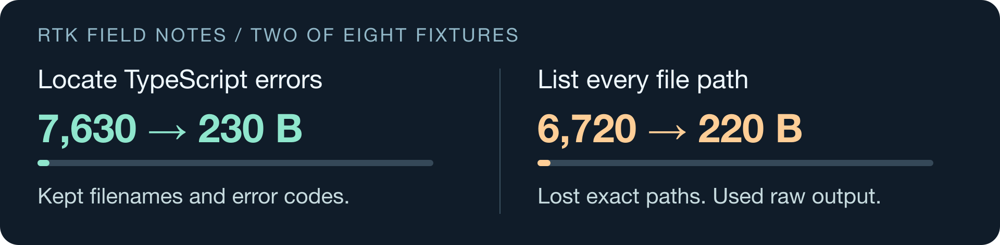

# Agent Token Saver

Give your coding agent the lines it needs from a build or test run. ATS saves the full stdout and stderr locally, preserves the exit code, and lets you search the log when the next question comes up.

[Quick start](#quick-start) · [Command reference](docs/QUICKSTART.en.md) · [Benchmark results](docs/BENCHMARK_REVIEW.md)

<a href="docs/RTK.md"><picture>
  <source media="(max-width: 600px)" srcset="docs/assets/rtk-mobile.png">
  
</picture></a>

## Quick start

With [Bun](https://bun.sh) installed, try the CLI from a checkout.

```sh
git clone -b v5.1.1 https://github.com/Supersynergy/agent-token-saver
cd agent-token-saver
bun run ats guide
```

To use `ats` in your own projects, run `bun install.ts --apply` and put `~/.local/bin` on your PATH. The installer prints a recovery ID. Omit `--apply` to preview the changes.

## Find an error after the check finishes

```sh
ats verify -- bun test
```

Use the log path from the result to find an earlier diagnostic, even when it fell outside the final lines shown to your agent.

```sh
ats project path/to/stderr.log --match TS2322
```

## When does filtering pay off?

Of eight synthetic RTK tasks, one produced a smaller answer with every required detail. Three saved zero bytes. Four dropped evidence the task required. The figure above shows why ATS checks what survived before accepting a shorter view. [Read the eight cases](docs/RTK.md).

[Speed and Superloop](docs/SPEED.md) · [20 skill principles](docs/SKILLS.md) · [Usage and rollback](docs/GUIDE.md) · [Migrate from v4](docs/MIGRATION.md)

[Release](https://github.com/Supersynergy/agent-token-saver/releases/latest) · [Contributing](.github/CONTRIBUTING.md) · [Security](.github/SECURITY.md) · [MIT license](LICENSE)
