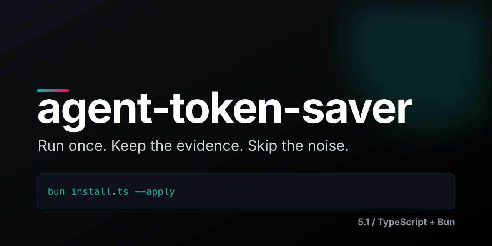

# agent-token-saver



**Run a check once. Keep the full evidence. Read only what you need.**
TypeScript/Bun tools for coding agents, with no runtime packages or API keys.

[](https://github.com/Supersynergy/agent-token-saver/actions/workflows/ci.yml)
[](LICENSE)
[](https://bun.sh)

```bash
git clone --branch v5.1.1 --depth 1 https://github.com/Supersynergy/agent-token-saver.git
cd agent-token-saver
bun install.ts --apply
```

Requires [Bun](https://bun.sh/docs/installation) and `~/.local/bin` on PATH.
For a preview, omit `--apply`. Without installing, use `bun run ats` instead of `ats`.

```bash
ats verify -- bun test                        # one run; original exit; full local logs
ats project build.log --match TS2322          # find an earlier error without rerunning
ats guide speed                              # choose the next useful step
```

[Guide](docs/GUIDE.md) · [All commands](docs/QUICKSTART.en.md) · [RTK results](docs/RTK.md) · [Benchmarks](docs/BENCHMARK_REVIEW.md) · [Migration](docs/MIGRATION.md) · [Release](docs/RELEASE-5.1.1.md)

<details>
<summary>What the evidence says</summary>

In eight synthetic RTK tasks, one candidate became smaller while preserving its
required literals. Three saved no bytes; four lost required evidence and fell
back to raw output. This is neither a general RTK failure rate nor a provider
savings claim. [Method and limits](docs/RTK.md).

The [20-skill design review](docs/SKILLS.md) and [Speed/Superloop review](docs/SPEED.md)
explain which principles survived the evidence. No automatic hooks, provider
routing, worker launches or background services are installed.

</details>

<details>
<summary>JSON, costs, rollback and safety</summary>

Use `ats --json ...` for scripts. A failing check keeps its original exit code;
timeout is 124 and an unavailable executable is 127. Tail views can miss earlier
errors. Raw stdout/stderr remain local and can contain anything the command prints.

`ats cost --example` uses synthetic prices. Supply your own dated tariff and
disjoint usage classes; the answer is an estimate, not an invoice.

The installer prints a recovery ID. From the checkout, run
`bun run ats rollback --id ID --apply` to restore prior starters. Later edits and
newer generations block rollback. Existing v4 host hooks need their own migration.

</details>

[Contribute](CONTRIBUTING.md) · [Security](SECURITY.md) · [MIT license](LICENSE)
