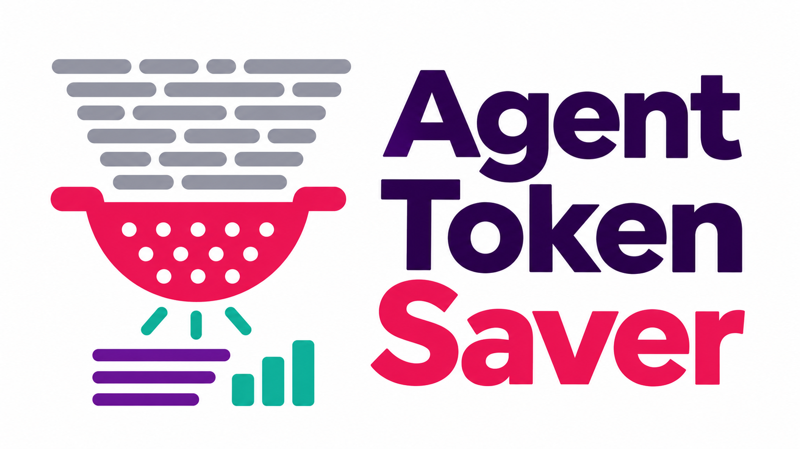

# agent-token-saver

[](https://github.com/Supersynergy/agent-token-saver/actions/workflows/ci.yml)
[](LICENSE)
[](https://bun.sh)

[English quick start](docs/QUICKSTART.en.md) · [Release 5.1](docs/RELEASE-5.1.0.md)

ATS hilft Coding-Agenten, Prüfergebnisse einmal zu erzeugen und die benötigten
Belege gezielt zu lesen. CLI, Installation und Tests laufen mit TypeScript/Bun.



```bash
git clone --branch v5.1.0 --depth 1 https://github.com/Supersynergy/agent-token-saver.git
cd agent-token-saver
bun run ats guide
bun run ats verify -- bun -e 'console.log("check passed")'
```

Bun genügt zum Benutzen. Es gibt keine Laufzeitpakete, keinen API-Schlüssel und
keine automatische Hook-Installation. RTK ist optional. Wer am Projekt arbeitet,
installiert mit `bun install --frozen-lockfile --ignore-scripts` die festgelegten
Entwicklungswerkzeuge und führt `just check` aus.

## Der nützlichste Filter ist oft eine genauere Frage

In unserem lokalen Vergleich sollte RTK eine Liste von 240 Dateipfaden kürzen.
Aus 6.720 Bytes wurden 220. Keiner der 240 vollständigen Pfade blieb erhalten.
Für eine Verzeichnisübersicht mag das reichen. Für die verlangte vollständige
Dateiliste ist es falsch.

Bei TypeScript-Fehlern funktionierte die Kürzung: 7.630 auf 230 Bytes, alle
festgelegten Dateinamen und Fehlercodes erhalten. Das ist der Unterschied, den
ATS sichtbar macht. [Alle 8 Fälle samt Grenzen](docs/RTK.md).

Die Leitfrage lautet: Welche Information brauche ich für den nächsten Schritt?
Eine gezielte Suche beantwortet sie oft mit weniger Aufwand als ein weiterer
Kompressor. Ein verlorener Fehler kostet eine neue Runde.

## Vier Aufgaben, die sofort helfen

- Check ausführen: `ats verify -- bun test`. Ergebnis und vollständige Logpfade bleiben erhalten.
- Frühen Fehler finden: `ats project build.log --match TS2322`. Die Ansicht nennt Zeilen und Auslassungen.
- Logende lesen: `ats project build.log --max-bytes 4096`. Das ist eine ausdrücklich begrenzte Vorschau.
- RTK prüfen: `ats bench --out ./rtk-report`. Der Bericht zeigt auch verworfene Kandidaten.

Ohne Installation ersetzt `bun run ats` das kurze `ats` in den Beispielen.
`ats guide` erklärt den Einstieg; `ats guide rtk` die Werkzeugwahl.

## Einmal prüfen, später im Rohbeleg nachlesen

```bash
bun run ats verify -- bun test ./test/core.test.ts
bun run ats --json verify -- bun test ./test/rtk.test.ts
```

Der angegebene Befehl läuft genau einmal als Argumentliste. Bei Erfolg erscheint
ein kurzes Ergebnis. Bei Fehlern zeigt ATS zusätzlich das Ende von stdout und
stderr, jeweils höchstens 16 KiB. Beide Rohdateien bleiben vollständig erhalten.

Der ursprüngliche Exitcode bleibt bestehen. Ein Zeitlimit liefert 124, ein nicht
startbarer Befehl 127. Die Endansicht kann einen frühen Fehler übersehen; nutze
für diesen Fall `project --match` auf dem gespeicherten Log. Das startet den
Check nicht erneut. [Details und Grenzen](docs/GUIDE.md).

## Lokal installieren und zurückbauen

```bash
bun install.ts                              # Plan anzeigen
bun install.ts --apply                      # ats und agent-token-saver installieren
ats doctor
ats guide
```

Die Installation schreibt eine eigene Generation und zwei Verknüpfungen nach
`~/.local/bin/`. Dieser Pfad muss in `PATH` stehen. Die Starter verweisen direkt
auf TypeScript-Dateien mit Bun-Shebang; eine Shell-Implementierung gibt es nicht.
Vorhandene Starter und der vorherige Versionszeiger stehen im privaten
Installationsbeleg. Die Ausgabe nennt dessen Kennung.

```bash
bun run ats rollback --id INSTALLATIONS_ID          # Plan
bun run ats rollback --id INSTALLATIONS_ID --apply  # vorherigen Zustand herstellen
```

`--home DIR` erlaubt eine Probeinstallation in einem eigenen Ordner.
Rückbau verweigert das Überschreiben später geänderter Starter. Generationen
bleiben erhalten. `doctor` prüft Dateien und Verknüpfungen; einen funktionierenden
Codex- oder Claude-Nutzerpfad beweist das nicht.

<details>
<summary>Cachekosten mit eigenen Eingaben berechnen</summary>


```bash
bun run ats cost examples/usage.json
```

Das Beispiel ergibt 0,0024 USD mit erfundenen Beispielpreisen. Ersetze Preise
und Quelle durch deinen datierten Tarif. Frische Eingabe, Cache-Lesen,
Cache-Schreiben und Ausgabe müssen getrennte Nutzungsklassen sein.
Mit `ats cost --example` funktioniert das Beispiel auch nach der Installation.
ATS normalisiert Anbieterformate nicht automatisch und nennt die Rechnung eine
Schätzung. Eine kleinere Logausgabe ist kein Beleg für eine entsprechend
kleinere Anbieterrechnung.

</details>

## Was aus dem alten Paket verschwindet

Die Python-Implementierungen, Shell-Helfer, Providervermittlung und überlappenden
Hookprofile sind aus dem gepflegten Quellbaum entfernt. Auch die alten Testläufer
werden nicht mehr als aktuelle Anleitung mitgeliefert. Der Ersatz ist in der
[Migrationsübersicht](docs/MIGRATION.md) aufgeführt. Historische Benchmarks bleiben
als Daten erhalten; sie tragen keine Spargarantie für den neuen Kern.

Persönlich installierte alte Hooks werden durch einen Checkout-Umbau nicht
entfernt. ATS verändert keine Host-Konfiguration und keine Agentenfreigaben.

## Weiterlernen

- [Anleitung mit Entscheidungsfällen](docs/GUIDE.md)
- [RTK: Gewinne, Gegenproben und Grenzen](docs/RTK.md)
- [Konzept und Erkenntnisse aus früheren Benchmarks](docs/CONCEPT.md)
- [20 SI-Atlas-Skills mit konkreter Anwendung](docs/SKILLS.md)
- [Zusätzliche Benchmark-Prüfung](docs/BENCHMARK_REVIEW.md)
- [Speed-Skills und Superloop: übernommene und verworfene Regeln](docs/SPEED.md)
- [Mitwirken und eigene Messungen](CONTRIBUTING.md)

Lizenz: MIT.
